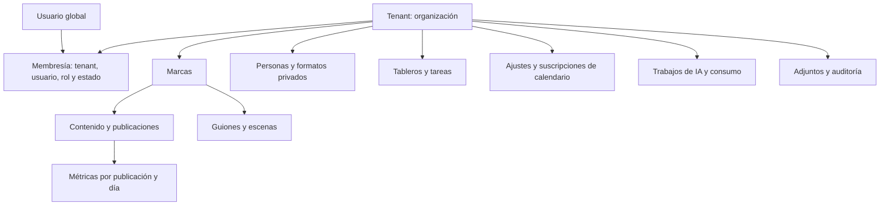

# Auditoría de Marketing OS: arquitectura, backend, base de datos y multitenancy

Fecha: 7 de septiembre de 2026. Proyecto revisado: `C:/Users/YONELIA/Desktop/intia-main`.

Esta auditoría conserva el estado previo a las correcciones. Seguimiento: [evaluación y plan de optimización de la navegación](./plan-optimizacion-navegacion-2026-09-07.md) y [mejoras implementadas el 8 de septiembre](./mejoras-navegacion-implementadas-2026-09-08.md). H03 se corrigió localmente y H14 recibió mejoras parciales; los restantes hallazgos no se dan por resueltos. La verificación del despliegue sigue pendiente.

**Conclusión:** hay una base aprovechable para una aplicación de una agencia que administra varias marcas. El sistema todavía no proporciona aislamiento entre organizaciones y no debería alojar clientes independientes en una misma instalación con su modelo actual. Es viable convertirlo en SaaS manteniendo Next.js y Prisma, mediante una refactorización transversal de propiedad de datos, autorización, trabajos de IA y operaciones de base de datos.

**No hace falta empezar de cero.** El trabajo prioritario consiste en introducir límites de acceso verificables y mejorar la integridad. Cambiar de framework o dividir todo en microservicios no resuelve por sí mismo ninguno de los riesgos principales encontrados.

## Alcance y evidencia

Se revisaron el esquema completo de 21 modelos, los módulos de Server Actions, las rutas API, autenticación, configuración, consultas de las pantallas principales, integración de IA y scripts de instalación. El árbol `src` contiene 107 archivos TypeScript/TSX y unas 33.346 líneas, incluyendo interfaz y contenido de referencia.

La carpeta recibida no incluye `.git`, `.env` ni una base de datos local. Por ello, la revisión no acredita el estado de producción, las políticas del proveedor, el volumen real, la distribución de datos ni los tiempos de consulta de una DB desplegada. Las recomendaciones de índices requieren contrastarse con planes de ejecución reales.

Comprobaciones realizadas:

| Comprobación | Resultado | Alcance real |
|---|---|---|
| Instalación del lockfile | Correcta, con `npm ci --ignore-scripts` | Dependencias fijadas, sin actualizar versiones |
| Generación de Prisma Client | Correcta, versión 6.19.3 | Generación local; no ejecuta migraciones |
| `prisma validate` | Correcto con URL PostgreSQL de prueba | Validez del esquema, no estado de una DB real |
| `tsc --noEmit --incremental false` | Correcto | Tipado de la copia revisada |
| `npm run build` | Correcto | Compilación Next.js 15.5.24, con URL ficticia local y sin acceso a datos reales |
| `npm run lint` | No operativo para CI | Solicita configurar ESLint y sale sin ejecutar una revisión configurada |
| Reproducciones de lógica | 11 comportamientos confirmados | Código original con DB, autenticación y Next simulados; no es una prueba HTTP/PostgreSQL integral |
| `npm audit --omit=dev --json` | 5 paquetes señalados: 4 high, 1 moderate | Avisos de dependencias, con propagación entre paquetes; no equivalen a cinco ataques demostrados |

Las reproducciones están en [reproducir-hallazgos.mjs](<C:/Users/YONELIA/Desktop/intia-main/reports/reproducir-hallazgos.mjs>). Se ejecutan con Node 24 desde el proyecto mediante `node reports/reproducir-hallazgos.mjs`. No conectan a la DB ni llaman a proveedores de IA. Confirman defectos actuales y deben cambiarse al corregirlos; no son una suite de aceptación del producto.

Las pruebas existentes `test:humo` y `test:motores` dependen de DB; la primera también necesita servidor y puede crear el token del calendario. No se ejecutaron contra ninguna base real. No se modificaron archivos funcionales en `src` ni el esquema Prisma. La instalación y el build generaron dependencias y artefactos locales habituales.

## Evaluación general

| Área | Evaluación | Fundamento |
|---|---|---|
| Organización del producto | Base razonable | Flujos de marca, contenido, guion, escenas y producción identificables |
| Backend para una organización | Aprovechable, con deuda relevante | Acciones por dominio y auth común; reglas repetidas y validación desigual |
| Modelo relacional | Intermedio | Buenas relaciones centrales; faltan restricciones, propiedad organizacional y algunas FK |
| Preparación multitenant | Baja | No existen Tenant, Membership ni restricciones por organización |
| Rendimiento al crecer | Mixto | Hay agregados y paginación; también carga completa de tablas/relaciones y procesamiento en memoria |
| Seguridad de aplicación | Requiere correcciones antes de ampliar exposición | Borrados indebidos, subida de tipos activos, inicializador sin auth y controles de sesión incompletos |
| Operación de un SaaS | Incompleta | No hay migraciones versionadas, cuotas por cliente, jobs de generación ni controles automatizados suficientes |

Aspectos que conviene conservar:

- Server Components para lecturas y Server Actions para escrituras encajan con este producto. Separar servicios internos no exige abandonar ese patrón.
- Prisma centralizado, TypeScript estricto, uso frecuente de `select`, `Promise.all`, `aggregate` y `groupBy`.
- Relaciones y unicidad para asignaciones, compatibilidad, métricas y escenas; creación anidada de guiones/escenas y videos/checklists.
- Índices útiles como `ContentItem(brandId, scheduledDate)`, `ScriptScene(scriptId, order)` y los del historial.
- Cookies HttpOnly, Secure en producción y SameSite; contraseñas con bcrypt; rol y estado activo consultados en DB. Desactivar una cuenta afecta sus siguientes peticiones autenticadas.
- OAuth comprueba `state`, email verificado, cuenta existente y vínculo de Google. No da de alta usuarios indiscriminadamente.
- La generación valida la salida estructurada con Zod. Las referencias tienen límites de caracteres y se leen sin recuperar los bytes de los adjuntos.
- Contenido pagina a 50 filas y actividad a 60: no es correcto afirmar que toda la aplicación carece de paginación.

## Hallazgos prioritarios

Las prioridades indican orden de atención: **P1** antes de ampliar el uso o habilitar clientes independientes; **P2** corrección siguiente por integridad, capacidad o mantenimiento. Un bloqueo SaaS no implica que exista hoy una fuga entre organizaciones ya desplegadas: no se inspeccionó ese entorno.

### H01 — P1 / bloqueo SaaS: multimarcas no equivale a multitenancy

`User.role` es global. `Brand`, `Structure`, `Archetype`, `AppSetting`, tareas y adjuntos no tienen organización propietaria. `getBrandContext()` obtiene todas las marcas y `brandWhere(null)` devuelve `{}`. Las mutaciones comprueban el nivel del usuario, pero localizan los objetos por su `id` sin comprobar pertenencia organizacional.

Por ejemplo, `actualizarVideo()` acepta un identificador, consulta ese video y lo actualiza; la marca activa no restringe esa operación. Las fichas y la descarga de archivos siguen el mismo modelo. Esto es consistente con un equipo interno que comparte todos los datos, pero insuficiente para vender espacios privados a distintos clientes. La vista «Todas las marcas» debe significar todas las del tenant autorizado.

**Mejora:** `Tenant` + `Membership`, un contexto autorizado por petición, acceso a datos limitado por tenant, comprobación de todas las relaciones y políticas de aislamiento en PostgreSQL. Mantener `brandId` como subdivisión comercial del tenant.

Evidencia: [schema.prisma](<C:/Users/YONELIA/Desktop/intia-main/prisma/schema.prisma:20>), [brand-context.ts](<C:/Users/YONELIA/Desktop/intia-main/src/lib/brand-context.ts:31>), [content.ts](<C:/Users/YONELIA/Desktop/intia-main/src/app/actions/content.ts:151>), [descarga de adjuntos](<C:/Users/YONELIA/Desktop/intia-main/src/app/api/assets/[id]/route.ts:19>).

### H02 — P1: un MEMBER puede borrar tareas y columnas completas

`eliminarTarea()` y `eliminarColumna()` exigen `LEVEL.MEMBER`. El contrato exige `OWNER` para destruir entidades completas y esas operaciones no están entre sus excepciones. Además, la FK de `Task.column` usa `onDelete: Cascade`: borrar una columna elimina sus tareas, incluidas las que no se ven por un filtro activo.

La reproducción ejecutó ambas acciones con nivel 1. No se trata únicamente de un botón visible por error: el servidor acepta el permiso incorrecto.

**Mejora:** exigir OWNER en los dos borrados, comprobar alcance, mostrar recuento completo y permitir mover tareas a otra columna antes de eliminar. Registrar la operación y ejecutar su parte relacional en una transacción.

Evidencia: [tasks.ts](<C:/Users/YONELIA/Desktop/intia-main/src/app/actions/tasks.ts:160>), [eliminarColumna](<C:/Users/YONELIA/Desktop/intia-main/src/app/actions/tasks.ts:218>), [cascada](<C:/Users/YONELIA/Desktop/intia-main/prisma/schema.prisma:710>), [contrato](<C:/Users/YONELIA/Desktop/intia-main/CONTRACT.md:59>).

### H03 — P1: inicialización de columnas exportada sin autenticación

`asegurarColumnasIniciales()` está exportada en un archivo `"use server"` y no llama a `requireUser` ni a `requireLevel`. Puede leer nombres de columnas y, si el tablero está vacío, crearlas. El build revisado la incluye como `exportedName` en `.next/server/server-reference-manifest.json`: no quedó eliminada de la compilación.

La autenticación de `/tareas` no sustituye una comprobación en la acción. La reproducción confirmó cero llamadas al guard de autenticación. No se realizó una petición HTTP contra producción.

**Mejora:** convertirla en un servicio interno `server-only`, autorizado mediante contexto, e inicializar el tablero de manera idempotente durante el alta de la organización. Si se mantiene como acción, debe autenticar y autorizar explícitamente. Evitar escrituras durante el render de una página.

Evidencia: [tasks.ts](<C:/Users/YONELIA/Desktop/intia-main/src/app/actions/tasks.ts:21>), [page.tsx](<C:/Users/YONELIA/Desktop/intia-main/src/app/(app)/tareas/page.tsx:18>). Next.js documenta que las Server Actions deben tratarse como endpoints públicos con comprobaciones propias de autorización: [guía de seguridad de Next.js 15](https://nextjs.org/docs/15/app/guides/data-security).

### H04 — P1: archivos de contenido activo servidos en el mismo origen

La subida comprueba tamaño, pero acepta el `file.type` y guarda incluso formatos que el extractor no admite. Tampoco valida que `ownerType` sea un tipo permitido ni que exista el dueño. La descarga responde con ese MIME y `Content-Disposition: inline`, sin una política CSP restrictiva definida en esa ruta.

La reproducción guardó un HTML inocuo con tipo `text/html` y un dueño inexistente; la ruta lo devolvió como HTML inline. Esto establece un vector de XSS almacenado si un usuario abre un archivo con contenido ejecutable. No se ejecutó un payload en el navegador ni se inspeccionaron cabeceras añadidas por un proxy externo. HttpOnly protege la lectura directa de la cookie, pero no sustituye el aislamiento del documento activo.

**Mejora:** lista permitida en servidor, detección de contenido, validación del dueño y su tenant, descarga como attachment cuando corresponda y dominio separado sin cookies de sesión para archivos. Si se permite vista previa, definir un sandbox apropiado. Incorporar cuotas de almacenamiento y límites de extracción de PDF.

Evidencia: [assets.ts](<C:/Users/YONELIA/Desktop/intia-main/src/app/actions/assets.ts:36>), [pdf.ts](<C:/Users/YONELIA/Desktop/intia-main/src/lib/pdf.ts:75>), [route.ts](<C:/Users/YONELIA/Desktop/intia-main/src/app/api/assets/[id]/route.ts:27>). Criterios de validación y ubicación: [OWASP File Upload](https://cheatsheetseries.owasp.org/cheatsheets/File_Upload_Cheat_Sheet.html).

### H05 — P1, condicionado a configuración/arranque: secreto público y bootstrap vulnerable a concurrencia

El validador productivo de `AUTH_SECRET` únicamente rechaza ausencia o longitud menor a 16. Admite la cadena pública de `.env.example` y 32 espacios. `authSecretIsWeak()` detecta parte del problema, pero solo informa: no impide firmar sesiones. La reproducción comprobó ambas aceptaciones; esto no significa que producción use esa configuración.

El alta inicial usa `count(OWNER activos) == 0` antes del `create`, sin serializar ambas operaciones ni exigir un secreto de instalación. Dos solicitudes concurrentes pueden crear dos propietarios; la simulación lo confirmó. La protección del último propietario usa también recuentos separados de la escritura: dos cambios simultáneos podrían dejar cero propietarios y reabrir el bootstrap.

**Mejora:** validar un secreto aleatorio de suficiente longitud y rechazar placeholders/espacios al arrancar. Provisionar el primer propietario mediante un mecanismo de instalación autenticado, deshabilitado al finalizar. Serializar las operaciones que preservan al último propietario, con bloqueo sobre la organización o aislamiento adecuado y reintentos.

Evidencia: [auth.ts](<C:/Users/YONELIA/Desktop/intia-main/src/lib/auth.ts:37>), [bootstrap](<C:/Users/YONELIA/Desktop/intia-main/src/app/actions/auth.ts:55>), [último dueño](<C:/Users/YONELIA/Desktop/intia-main/src/app/actions/team.ts:180>). Prisma describe conflictos de escritura y reintentos para transacciones serializables: [documentación de transacciones v6](https://www.prisma.io/docs/orm/v6/prisma-client/queries/transactions).

### H06 — P1: importar columnas parciales puede borrar métricas existentes

`importarMetricasCsv()` convierte columnas ausentes a cero y construye un `update` con todas las métricas. Un CSV que solo trae video, fecha y vistas sobre una fila con ingresos 500, inversión 100 y 25 likes termina con esos tres valores en cero. La reproducción confirmó esa escritura.

**Mejora:** separar campo ausente, campo vacío y cero explícito. Actualizar únicamente columnas presentes y válidas; ofrecer un modo de reemplazo completo si el negocio lo necesita. Mostrar una previsualización de cambios, registrar el lote y conservar valores anteriores suficientes para revertirlo.

Evidencia: [conversión de métricas](<C:/Users/YONELIA/Desktop/intia-main/src/app/actions/metrics.ts:499>), [upsert de importación](<C:/Users/YONELIA/Desktop/intia-main/src/app/actions/metrics.ts:549>).

### H07 — P2: fechas dependientes de la zona del servidor e importación de días inexistentes

La escritura de eventos con hora usa `instantInZone(..., America/Lima)`, pero la lectura usa getters locales (`getHours`, `getDate`). En un host UTC, una reunión de las 10:00 de Lima se presenta a las 15:00. La página de calendario usa esos getters para rellenar el formulario de edición: volver a guardar puede desplazar otra vez el evento.

También `fromDateKey('2026-09-07')` produce 12:00Z en un host UTC y 17:00Z en Lima. Como la clave única de Metric incluye un `DateTime`, el mismo día lógico puede tener dos claves distintas si lo escriben procesos con zonas diferentes. `parseFecha('2026-02-31')` acepta el dato y JavaScript lo convierte en 3 de marzo. Los tres comportamientos se reprodujeron.

**Mejora:** distinguir fechas civiles (`DATE`) de instantes (`timestamptz`/UTC), guardar zona IANA por tenant y usarla explícitamente al formatear y construir rangos. Validar fechas por calendario, no solo con regex. Normalizar fechas históricas y detectar duplicados antes de cambiar la restricción única.

Evidencia: [utils.ts](<C:/Users/YONELIA/Desktop/intia-main/src/lib/utils.ts:157>), [hora del formulario](<C:/Users/YONELIA/Desktop/intia-main/src/app/(app)/calendario/page.tsx:218>), [parseFecha](<C:/Users/YONELIA/Desktop/intia-main/src/app/actions/metrics.ts:324>).

### H08 — P2: métricas con una granularidad insuficiente y retención incorrecta

`Metric` identifica video + fecha, sin plataforma ni cuenta social. Sin embargo, un video puede tener varias plataformas. El gráfico suma todas las vistas del video en cada red; el propio código reconoce esa limitación. Es una atribución no desglosada, no una medida real por plataforma.

El promedio de retención ignora valores cero y no pondera por el denominador de reproducciones. Dos filas con 100 vistas cada una y retenciones 0% y 100% se muestran como 100%, cuando en ese ejemplo correspondería 50%. La reproducción confirmó el resultado. El esquema tampoco distingue cero real de dato no suministrado.

**Mejora:** crear `Publication`/`SocialAccount` y métricas por publicación, día y fuente. Definir si los datos son incrementos diarios o snapshots acumulados; sumar snapshots produciría sobreconteo. Para retención y alcance, documentar denominadores y propiedades de agregación; usar NULL para desconocido, conservar ceros válidos y calcular tasas desde numerador/denominador compatibles.

Evidencia: [Metric](<C:/Users/YONELIA/Desktop/intia-main/prisma/schema.prisma:501>), [promedio](<C:/Users/YONELIA/Desktop/intia-main/src/app/(app)/metricas/page.tsx:115>), [atribución por red](<C:/Users/YONELIA/Desktop/intia-main/src/app/(app)/metricas/page.tsx:338>).

### H09 — P2: validación de entradas desigual; tipado no equivale a validación

`cambiarEstado()` acepta cualquier cadena no vacía. La reproducción guardó `ESTADO_INEXISTENTE`. Las tareas permiten `kind`, `priority`, identificadores y órdenes sin una validación de dominio común. Varias escrituras manuales de métricas admiten negativos. Los tipos TypeScript y los selectores HTML no protegen frente a entradas manipuladas.

**Mejora:** esquemas Zod de entrada por caso de uso, límites de longitud/cantidad, números finitos y rangos válidos, enumeraciones, fechas reales, URLs permitidas y relaciones autorizadas. Añadir CHECK/enum en DB para invariantes críticas, además de la validación de aplicación. Unificar las implementaciones duplicadas de métricas en `content.ts` y `metrics.ts`.

Evidencia: [cambiarEstado](<C:/Users/YONELIA/Desktop/intia-main/src/app/actions/content.ts:188>), [crearTarea](<C:/Users/YONELIA/Desktop/intia-main/src/app/actions/tasks.ts:52>), [guardar métricas](<C:/Users/YONELIA/Desktop/intia-main/src/app/actions/content.ts:479>).

### H10 — P2: auditoría incompleta y operaciones no atómicas

Las tareas y `procesarInformeBranding()` escriben sin `logAudit`. El helper de auditoría usa el cliente global y captura los errores, por lo que una operación puede completarse sin dejar registro. Algunas entradas contradicen el contrato de guardar valores originales: por ejemplo, un estado se registra mediante su etiqueta visible y el cambio de arquetipo de usuario mediante su nombre.

El reordenamiento de escenas usa transacciones para ciertos bloques, pero la edición inicial, la lectura de escenas, su reordenación y el total del guion no forman una única operación. Tampoco hay control de versión para evitar que dos editores se sobrescriban. El campo `Script.version` se incrementa al duplicar, no funciona como bloqueo optimista de las ediciones normales.

**Mejora:** servicios de aplicación con cliente transaccional, auditoría obligatoria para cambios críticos o un outbox persistido en la misma transacción. `version` comprobada en el WHERE para edición concurrente y respuesta clara ante conflicto. Mantener transacciones cortas; ninguna llamada de IA dentro de ellas.

Evidencia: [tasks.ts](<C:/Users/YONELIA/Desktop/intia-main/src/app/actions/tasks.ts:52>), [branding-extractor.ts](<C:/Users/YONELIA/Desktop/intia-main/src/app/actions/branding-extractor.ts:19>), [audit.ts](<C:/Users/YONELIA/Desktop/intia-main/src/lib/audit.ts:53>), [escenas](<C:/Users/YONELIA/Desktop/intia-main/src/app/actions/scripts.ts:57>), [etiquetas de estado](<C:/Users/YONELIA/Desktop/intia-main/src/app/actions/content.ts:212>).

### H11 — P2: archivos huérfanos al eliminar una marca

`eliminarMarca()` elimina adjuntos cuyo dueño es directamente la marca y luego elimina la marca. Los videos desaparecen por cascada, pero sus adjuntos tienen un dueño polimórfico sin FK y quedan almacenados. La acción especial de vaciar datos de ejemplo sí recorre y limpia adjuntos de videos: existe una diferencia concreta entre ambos caminos.

También hay identificadores sin relación formal: `CalendarEvent.contentItemId`, `Script.archetypeId` y `Asset.uploadedById`. Algunos campos de MatchRun/AuditLog son snapshots históricos deliberados y no deberían transformarse automáticamente en FK.

**Mejora:** modelar relaciones reales donde corresponda, separar referencias históricas explícitas y establecer una política uniforme de eliminación. Para assets, usar relaciones de adjuntos verificables y limpieza transaccional de metadatos; si los bytes están fuera de DB, borrar mediante jobs idempotentes. Comprobar huérfanos antes y después de la migración.

Evidencia: [eliminarMarca](<C:/Users/YONELIA/Desktop/intia-main/src/app/actions/brands.ts:256>), [Asset](<C:/Users/YONELIA/Desktop/intia-main/prisma/schema.prisma:320>), [cascada de videos](<C:/Users/YONELIA/Desktop/intia-main/prisma/schema.prisma:416>), [limpieza especial](<C:/Users/YONELIA/Desktop/intia-main/src/app/actions/datos-de-ejemplo.ts:166>).

### H12 — P2: cambios de guion pueden dejar información incoherente en videos

Al vincular un guion, el video copia `structureId`. Si después cambia la estructura del guion, `actualizarGuion()` no sincroniza los videos. Si se elimina el guion, la FK limpia `scriptId`, pero la estructura y el estado del video pueden permanecer. Además, se admite vincular un guion de una marca a un video de otra, sin una regla explícita que autorice o rechace esa reutilización.

**Mejora:** decidir si la estructura del video es derivada del guion o un snapshot de producción. Si es derivada, evitar la duplicación o mantenerla transaccionalmente; si es snapshot, versionarlo y nombrarlo como tal. Definir la política de reutilización entre marcas del mismo tenant y prohibir referencias entre tenants.

Evidencia: [actualizarGuion](<C:/Users/YONELIA/Desktop/intia-main/src/app/actions/scripts.ts:312>), [asignarGuionAVideo](<C:/Users/YONELIA/Desktop/intia-main/src/app/actions/scripts.ts:707>), [ContentItem](<C:/Users/YONELIA/Desktop/intia-main/prisma/schema.prisma:435>).

### H13 — P1 para SaaS / P2 interno: IA síncrona sin cuotas ni persistencia de trabajos

`generarGuion()` procesa secuencialmente las estructuras recibidas dentro de la petición. No impone un máximo de lote ni presupuesto por usuario/tenant. Existe `maxDuration = 300` en la página del generador, pero eso no garantiza completar un lote ni permite recuperarlo tras una interrupción. El streaming de Claude se consume con `finalMessage()` dentro del servidor.

La generación recibe consumo de tokens, pero no lo persiste en los guiones. MatchRun tiene campos de consumo para otro flujo; no existe una implementación activa que convierta esos modelos en un registro de generación de guiones. Si un proveedor responde pero falla el guardado, se pierde el resultado pagado; reintentar no es idempotente. Gemini reintenta sin esquema ante cualquier excepción, no exclusivamente ante un rechazo del esquema.

**Mejora:** `GenerationJob` persistido con tenant, actor, clave de idempotencia, estado, intentos, resultado y consumo. Worker con concurrencia limitada y reintentos selectivos; reserva atómica de cuota antes de llamar al proveedor, conciliación posterior, límites de lote/contexto y estados parciales visibles. Persistir cada resultado para poder reanudar sin volver a pagar por lo ya completado.

Evidencia: [generarGuion](<C:/Users/YONELIA/Desktop/intia-main/src/app/actions/scripts.ts:101>), [lote secuencial](<C:/Users/YONELIA/Desktop/intia-main/src/app/actions/scripts.ts:146>), [proveedores](<C:/Users/YONELIA/Desktop/intia-main/src/lib/ai/providers.ts:39>), [maxDuration](<C:/Users/YONELIA/Desktop/intia-main/src/app/(app)/generador/page.tsx:13>), [MatchRun](<C:/Users/YONELIA/Desktop/intia-main/prisma/schema.prisma:585>).

### H14 — P2: consultas y cargas que crecerán con todo el historial

- `/tareas` envía todas las columnas y todas sus tareas al cliente, y filtra allí. El `brandId` de la columna ni siquiera restringe la consulta del servidor.
- `/metricas` carga las filas del periodo actual y anterior y agrega en JavaScript. Limita a 366 días, pero no el número de videos ni de filas en ese intervalo.
- `/equipo` lee todas las asignaciones históricas para contar participación.
- El importador CSV carga todos los videos y hace lectura + upsert secuencial por fila.
- `/guiones` hace `take: 200` sin paginación para acceder al resto de la colección filtrada.
- Layout y páginas repiten lecturas de sesión y marcas sin deduplicación explícita por petición.

**Mejora:** filtrar por tenant y marca en SQL; paginar tareas y guiones; agregar métricas/participación en DB; resolver referencias de CSV por lote y persistir lotes controlados. Usar caché por petición para sesión/contexto y claves con tenant para cualquier caché compartida. Medir antes de introducir resúmenes materializados o un almacén analítico.

Evidencia: [tareas](<C:/Users/YONELIA/Desktop/intia-main/src/app/(app)/tareas/page.tsx:21>), [métricas](<C:/Users/YONELIA/Desktop/intia-main/src/app/(app)/metricas/page.tsx:230>), [equipo](<C:/Users/YONELIA/Desktop/intia-main/src/app/(app)/equipo/page.tsx:74>), [CSV](<C:/Users/YONELIA/Desktop/intia-main/src/app/actions/metrics.ts:423>), [guiones](<C:/Users/YONELIA/Desktop/intia-main/src/app/(app)/guiones/page.tsx:60>).

### H15 — P1 antes de una migración SaaS: evolución de DB sin historial versionado

No hay carpeta de migraciones ni SQL de evolución versionado en la copia recibida. Los scripts y README usan `prisma db push`, y el cambio SQLite/PostgreSQL edita el proveedor en el mismo archivo. `.env.example` propone SQLite mientras el esquema revisado está en PostgreSQL. Copiar esa configuración sin alinear el proveedor produce un entorno inconsistente.

**Mejora:** PostgreSQL también en desarrollo y pruebas de integración; baseline del estado real y migraciones revisadas con `migrate deploy` en despliegues. Separar seeds de catálogos, datos demo y producción. Copias de seguridad con restauración ensayada; validar backfills y restricciones antes de aplicarlas. `db push` sirve para prototipar y no crea un historial de migraciones: [documentación Prisma v6](https://www.prisma.io/docs/orm/v6/prisma-migrate/workflows/prototyping-your-schema).

Evidencia: [package.json](<C:/Users/YONELIA/Desktop/intia-main/package.json:11>), [switch-db.mjs](<C:/Users/YONELIA/Desktop/intia-main/scripts/switch-db.mjs:9>), [.env.example](<C:/Users/YONELIA/Desktop/intia-main/.env.example:1>), [datasource](<C:/Users/YONELIA/Desktop/intia-main/prisma/schema.prisma:13>).

### H16 — P2: gestión de credenciales, sesiones y calendario insuficiente para varios clientes

Las claves de IA y el secreto OAuth guardados desde la UI se persisten como texto en `AppSetting`; no hay cifrado de aplicación por campo. La configuración de IA es global y las variables de entorno prevalecen para todos. El token de calendario es único para toda la instalación: añadir `marca=...` restringe una consulta, no el alcance del token. Quien recibe un enlace filtrado puede quitar ese parámetro y consultar el calendario conjunto.

Las sesiones duran 30 días. Cambiar la contraseña modifica el hash pero no revoca JWT ya emitidos. No se encontró limitación de intentos de login en el código. No se verificó si el alojamiento añade controles externos.

**Mejora:** separar configuración de plataforma y de tenant; cifrar secretos con una clave gestionada fuera de la DB; registrar rotación sin valores sensibles. Añadir sesiones revocables o `sessionVersion`, reautenticación para operaciones sensibles y límites distribuidos de intentos. Crear suscripciones de calendario con tenant y ámbito inmutables, token aleatorio almacenado mediante hash y revocación individual; revisar su política de caché para no prolongar acceso revocado.

Evidencia: [settings.ts](<C:/Users/YONELIA/Desktop/intia-main/src/lib/settings.ts:33>), [sesión](<C:/Users/YONELIA/Desktop/intia-main/src/lib/auth.ts:88>), [contraseña](<C:/Users/YONELIA/Desktop/intia-main/src/app/actions/team.ts:249>), [token](<C:/Users/YONELIA/Desktop/intia-main/src/lib/ical.ts:16>), [feed](<C:/Users/YONELIA/Desktop/intia-main/src/app/api/calendario.ics/route.ts:35>).

### H17 — P2: almacenamiento y restricciones de DB mejorables

Los bytes de todos los archivos viven en `Asset.data`, junto con texto extraído de hasta 200.000 caracteres. A mayor uso crecen DB, backups y transferencia de descargas. Es una simplificación válida para empezar, pero un coste que conviene separar al crecer.

Muchas listas/estructuras se guardan como JSON dentro de String. Esto dificulta restricciones, búsquedas e índices semánticos. `platformFilter()` usa `contains` sobre el texto serializado. `Metric.spend` y `revenue` son Float y no incluyen moneda. Los índices existen, pero aún no están diseñados alrededor del tenant ni cubren varios órdenes/filtros habituales.

**Mejora:** object storage privado para bytes y DB para metadatos; JSONB para estructuras documentales flexibles y tablas de relación para entidades consultables, como publicaciones/redes. Importes en Decimal o unidades mínimas enteras con moneda. Restricciones para estados/rangos y FK faltantes. Evitar añadir índices indiscriminadamente: cada índice también cuesta en escrituras y mantenimiento.

Evidencia: [Asset](<C:/Users/YONELIA/Desktop/intia-main/prisma/schema.prisma:320>), [Metric](<C:/Users/YONELIA/Desktop/intia-main/prisma/schema.prisma:518>), [platformFilter](<C:/Users/YONELIA/Desktop/intia-main/src/lib/constants.ts:217>).

### H18 — P2: faltan controles automáticos y hay dependencias con avisos

`eslint.ignoreDuringBuilds = true`, no se incluye configuración ESLint ni dependencia directa del linter, y `npm run lint` abre el asistente de configuración. No se encontró CI en esta copia. Un build exitoso no detecta los defectos de negocio demostrados.

El lockfile fija Next 15.5.24, React/React DOM 19.2.8 y Prisma 6.19.3. La auditoría npm del día señaló la cadena `deepmerge-ts → @prisma/config → prisma` y PostCSS dentro de Next. Estos avisos tienen condiciones específicas; no se demostró una ruta de explotación desde entradas del producto. En particular, el aviso de deepmerge requiere objetos recursivos y el de PostCSS procesamiento de CSS/source maps no confiables. No corresponde inferir vulnerabilidades antiguas solo leyendo el rango de `package.json`, ni aplicar una actualización mayor forzada sin comprobar compatibilidad.

**Mejora:** configurar lint no interactivo, CI con instalación reproducible, tipado, build y pruebas de permisos/integridad. Revisar parches compatibles y el alcance real de dependencias de build/runtime. Establecer seguimiento de avisos y actualizaciones periódicas.

Evidencia: [next.config.ts](<C:/Users/YONELIA/Desktop/intia-main/next.config.ts:19>), [package.json](<C:/Users/YONELIA/Desktop/intia-main/package.json:10>), [lockfile](<C:/Users/YONELIA/Desktop/intia-main/package-lock.json:1>). Avisos consultados: [DeepmergeTS](https://github.com/advisories/GHSA-ggr8-5vv4-36mx), [PostCSS sourceMappingURL](https://github.com/advisories/GHSA-6g55-p6wh-862q), [corrección incompleta PostCSS](https://github.com/advisories/GHSA-fxqj-rqcc-2cmp).

### H19 — P2: «vaciar datos de ejemplo» no distingue todos los datos creados por el usuario

La limpieza elimina todos los arquetipos con `isPerson: false`. Esa propiedad distingue un perfil genérico de una persona real, pero no identifica que el registro proceda del seed. Un perfil genérico creado o adaptado por el usuario también cumple el filtro y puede desaparecer. El recuento previo y la confirmación reducen accidentes, pero no corrigen la clasificación del dato.

**Mejora:** marcar procedencia con `seedKey`, `isDemo` o una relación al lote de inicialización. Limpiar exclusivamente registros demostrativos identificados de forma estable, con una política explícita para los que fueron editados o reutilizados. Revisar del mismo modo los datos reales que puedan haberse añadido a la marca de ejemplo.

Evidencia: [limpieza de perfiles](<C:/Users/YONELIA/Desktop/intia-main/src/app/actions/datos-de-ejemplo.ts:184>), [creación de arquetipos](<C:/Users/YONELIA/Desktop/intia-main/src/app/actions/archetypes.ts:116>).

## Arquitectura multitenant propuesta

Asumo que cada cliente es una organización/agencia con una o varias marcas y que una persona puede pertenecer a varias organizaciones. Esta hipótesis permite conservar el modelo multimarcas existente y dar a cada cliente su espacio privado.

Modelo mínimo y decisiones importantes:

| Modelo/área | Propuesta |
|---|---|
| `Tenant` | id, slug, nombre, estado, zona horaria y moneda predeterminada |
| `User` | Identidad y credenciales globales. Puede conservar email único global |
| `Membership` | tenantId, userId, role, active; única por tenant + usuario. Perfil/arquetipo organizacional aquí si corresponde |
| Roles | Mantener exactamente OWNER y MEMBER por membresía, como establece el contrato. La administración de la plataforma debe tener un mecanismo separado |
| Datos privados | tenantId obligatorio aunque brandId sea opcional. Un guion «sin marca» sigue perteneciendo a una organización |
| Slugs | Unicidad por tenant en marcas, personas y formatos privados; no global |
| Catálogos compartidos | Plantillas de plataforma versionadas y de solo lectura; copias/adaptaciones privadas de cada tenant |
| Configuración | Separar claves de plataforma de `TenantSetting(tenantId, key)`; secretos cifrados |
| `CalendarSubscription` | tenantId, alcance autorizado, tokenHash, estado y fecha de revocación |
| `GenerationJob` / consumo | tenantId, actor, estado, idempotencyKey, intentos, resultado, tokens y coste cuando se conozca |
| Archivos | tenantId, propietario verificado, objectKey, hash, tamaño y estado del procesamiento |

La organización activa seleccionada en cookie o ruta es únicamente una solicitud del cliente. El servidor debe resolverla contra una membresía activa. Si falta tenant o no está autorizado, se rechaza; nunca se degrada a consultar todos los registros.

**Mantendría un monolito modular**, con este flujo:

`Server Action → validación → contexto autorizado → servicio de aplicación → acceso a datos por tenant → transacción/DB`

Los servicios concentran reglas como asignar guion, eliminar columna o importar métricas. Las páginas reciben DTOs con lo necesario. El acceso Prisma sin alcance queda reservado a módulos explícitos de plataforma/mantenimiento. Añadir una extensión Prisma puede ayudar, pero no basta sin tratar relaciones anidadas, lecturas, agregados, SQL directo, jobs y acciones fuera de las páginas.

### Elección del aislamiento de DB

| Alternativa | Ventaja | Coste/limitación | Aplicación a este sistema |
|---|---|---|---|
| DB y esquema compartidos + tenantId + RLS | Operación y migraciones unificadas; buen aprovechamiento de recursos | Exige disciplina de acceso, FK y políticas; recursos compartidos | Opción inicial recomendada |
| Esquema por tenant | Separación de objetos SQL | Migraciones y configuración por esquema; recursos de instancia compartidos | No aporta una ventaja clara para esta primera migración |
| DB por tenant | Mayor separación, restauración y cuotas operativas independientes | Más pools, migraciones, backups y coste de operación | Alternativa para clientes con requisitos especiales; también puente temporal para pilotos separados |

La recomendación es de arquitectura; no presupone un número de clientes soportado. Instancias separadas reducen el riesgo de mezcla entre clientes, pero no corrigen los bugs funcionales y de seguridad descritos.

**Defensa en PostgreSQL:** tenantId y claves foráneas compuestas para impedir asociaciones entre organizaciones, por ejemplo `(tenantId, brandId) → Brand(tenantId, id)`. Extender la protección a hijos como escenas, comentarios y asignaciones, directamente o mediante una relación autorizada verificable.

Aplicar RLS a lecturas y escrituras con contexto de tenant establecido localmente dentro de una transacción. Con pool de conexiones, no usar un `SET` de sesión que pueda quedar para la siguiente petición; el contexto debe durar únicamente la operación. El rol de aplicación no debe ser superusuario ni tener BYPASSRLS, y hay que tratar explícitamente el bypass del propietario de tablas. Probar las políticas con el rol real de la aplicación, no con el usuario de migraciones. La documentación explica los bypass y `FORCE ROW LEVEL SECURITY`: [PostgreSQL RLS](https://www.postgresql.org/docs/17/ddl-rowsecurity.html).

Esto complementa la autorización del backend. RLS no sustituye las comprobaciones de OWNER/MEMBER, límites de consumo, transiciones o permisos de negocio.

### Índices iniciales a evaluar

Como punto de partida, condicionado a consultas reales y `EXPLAIN (ANALYZE, BUFFERS)` en un entorno de pruebas:

- `Membership(userId, active, tenantId)` y unicidad `(tenantId, userId)`.
- `ContentItem(tenantId, brandId, scheduledDate, id)` para calendario y listas por marca; evaluar otra variante para listados conjuntos sin marca.
- `Script(tenantId, brandId, updatedAt, id)` para biblioteca paginada.
- `Task(tenantId, columnId, order, id)` y acceso de tareas asignadas según el filtro usado.
- `AuditLog(tenantId, createdAt, id)` y variante por entidad si las consultas lo requieren.
- Unicidad de métricas según la granularidad elegida, por ejemplo `(tenantId, publicationId, date, source)`; índice temporal para reportes.

Agregar `id` al orden para desempatar y usar cursores estables en recorridos grandes. Las búsquedas `contains` pueden requerir trigramas/full text si el volumen lo justifica. No hay evidencia de planes reales que permita prometer una mejora porcentual concreta.

## Plan de implementación por etapas

| Etapa | Trabajo | Condición para cerrar |
|---|---|---|
| 1. Corregir riesgos actuales | H02–H07, validación de estados, sesiones y auditoría crítica; configurar CI | Pruebas de regresión que rechacen las operaciones indebidas y preserven datos |
| 2. Establecer migraciones | Identificar esquema desplegado, baseline, PostgreSQL de pruebas, separar seeds, ensayar backup/restore | Un entorno vacío y una copia de datos existentes llegan al mismo esquema verificable |
| 3. Modelar organizaciones | Tenant/Membership, clasificación de catálogos, contexto autorizado y servicios de acceso | Las operaciones nuevas requieren contexto y mantienen los dos roles por tenant |
| 4. Migrar datos existentes | Asignar un tenant inicial, backfill por lotes, resolver huérfanos y colisiones, adaptar FK/índices | Ninguna fila privada sin dueño; restricciones y recuentos verificados |
| 5. Completar aislamiento | Acciones, páginas, adjuntos, feeds, CSV, IA, cachés y RLS | Batería de pruebas A/B y rol DB real sin accesos cruzados |
| 6. Preparar crecimiento | Workers de IA/importación, idempotencia, cuotas, object storage, agregados y paginación | Pruebas de fallo/reintento/carga con límites por tenant |
| 7. Piloto y observación | Onboarding, suspensión, exportación, eliminación, restauración, métricas operativas | Operación de clientes independientes con alarmas y recuperación ensayadas |

Para migrar sin una reescritura abrupta, usar expansión y contracción: agregar columnas y tablas, backfill, desplegar código adaptado, validar y después endurecer restricciones/eliminar compatibilidad antigua. No incorporar un segundo cliente mientras sobrevivan caminos globales o despliegues antiguos capaces de omitir el contexto del tenant. No inferir que `brandId = null` significa «público».

La migración de archivos puede hacerse gradualmente: copiar bytes a object storage, verificar hash/tamaño, cambiar lecturas y eliminar bytes antiguos solo tras la validación y el periodo de recuperación acordado.

## Pruebas y mediciones necesarias antes del lanzamiento SaaS

Priorizar pruebas de comportamiento e integridad, además del tipado:

1. Dos tenants, un usuario miembro en uno, otro usuario en ambos, roles distintos por tenant y un usuario suspendido. Comprobar listas, detalles, acciones y relaciones manipuladas.
2. Intentar referencias cruzadas de marca, columna, guion, escena, archivo, usuario asignado y métrica; la aplicación y la DB deben rechazarlas.
3. Exportación/importación y calendario limitados a su alcance; quitar/cambiar parámetros no amplía permisos.
4. OWNER y MEMBER frente a cada operación destructiva; preservar al último dueño con solicitudes concurrentes.
5. CSV parcial, fechas inexistentes, porcentajes cero, importes negativos y duplicados por día; ninguna pérdida silenciosa.
6. Dos ediciones simultáneas del mismo guion/tablero; detectar conflicto y mantener órdenes/totales válidos.
7. Fallos entre respuesta de IA y guardado, caída de worker y reintento: no perder resultados ni crear duplicados evitables.
8. Lecturas y escrituras RLS usando el pool y el rol de aplicación; verificar que un contexto no contamine otra petición.
9. Restauración de backup y migración sobre copia representativa; eliminación/exportación de una organización con sus adjuntos.

La prueba de carga debe reproducir mezcla de calendario, cambios de tareas, búsquedas, reportes, importaciones y generación. Medir p50/p95/p99, errores, conexiones activas/espera, CPU/memoria de DB y aplicación, filas/bytes leídos, tamaño de respuestas, retraso de jobs y consumo por tenant. Aumentar tenants, datos y concurrencia por separado para encontrar el límite real y detectar que un cliente monopolice recursos.

Los límites publicados por Vercel/otro host, la configuración real del pool, región de DB, backups y cabeceras externas deben verificarse sobre el despliegue. En alojamiento propio con varias instancias, coordinar versión de despliegue, caché y claves de Server Actions según [guía oficial de self-hosting](https://nextjs.org/docs/app/guides/self-hosting).

**Decisión propuesta:** conservar el stack y refactorizar por etapas. Primero seguridad e integridad; después aislamiento completo; luego capacidad y operación. La conversión a multitenant afecta todo el recorrido del dato, desde la membresía hasta los adjuntos y los trabajos de IA, y merece tratarse como una iniciativa de arquitectura verificable.
